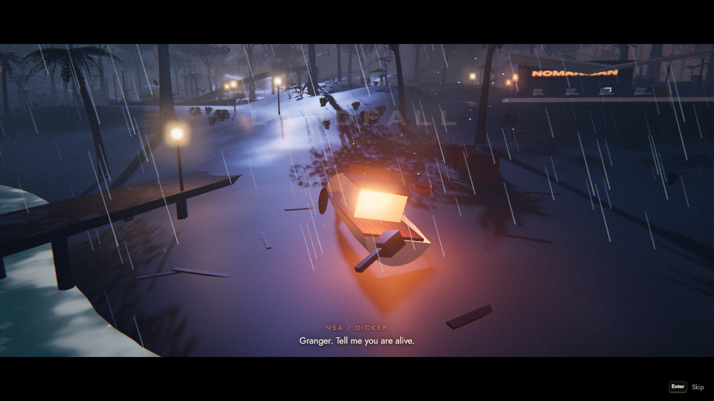
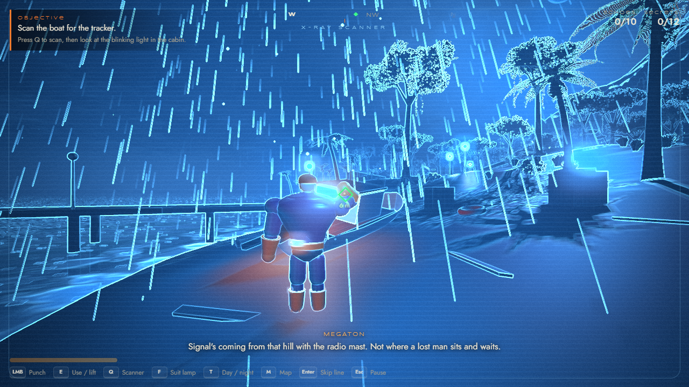
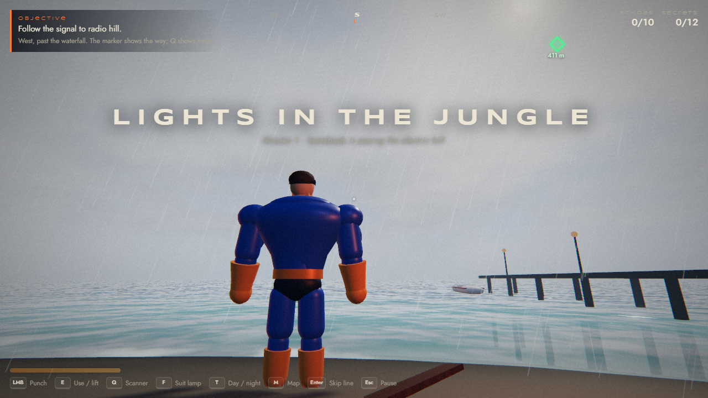
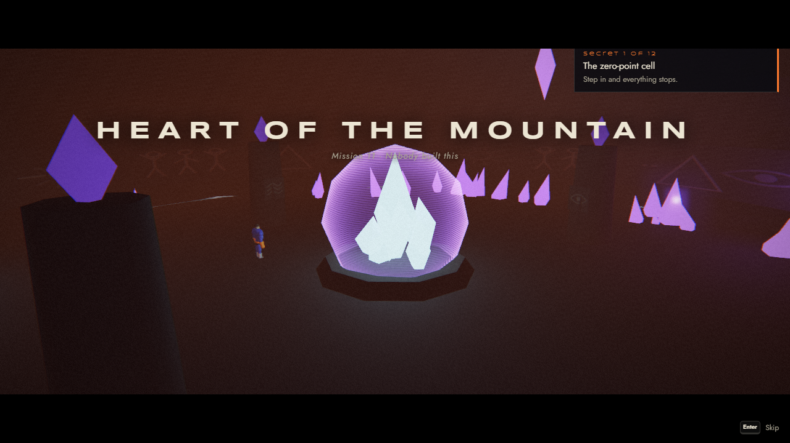

# Nomanisan Island: Kronos Protocol
I KNOW ITS NOT GOOD JUST A "PROTOTYPE" YOU CAN GET IT AND UPGRADE IT


A fan-made, third-person superhero adventure set on Syndrome's volcano island from Pixar's *The Incredibles* (2004). It runs in the browser: one HTML file, Three.js, no install.

**Play it:** https://mantinmilano.github.io/nomanisan-island/



Three nights ago a dead hero's beacon switched on in the middle of the ocean. You play Megaton, a retired strongman hero, who comes ashore to find out who flipped the switch. What Syndrome left behind is still running, and the volcano has been keeping something.

## What's in it

- 13 voiced missions plus free roam, with Syndrome as a ghost in his own computer, Mirage, and Gazerbeam's echo
- Punch combos with lock-on, super jumps, ground slams, lifting and throwing crates, drums and boulders, rocket boots with double jump and glide
- An X-ray scanner that shows clues, enemies, cracked walls and the way forward through rock
- Security cameras you can hack or break, drones, spider-bots and two boss fights
- Day and night you can switch any time, plus clear, rain and storm weather
- Ten hidden echo shards that unlock upgrades, and twelve secrets
- A test menu for jumping to any mission or place



## Controls

| Key | Action |
| --- | --- |
| W A S D, mouse | Move, turn the camera. Shift runs. |
| Space | Jump. Hold and release for a super jump. In the air: jump again with the boots, hold to glide. |
| Left mouse | Punch. In the air: slam down. Carrying something: throw it. |
| E | Use things, lift and drop objects. Hold E on a camera while scanning to hack it. |
| Q | X-ray scanner |
| T | Day / night |
| F | Suit lamp |
| M | Map, missions, secrets |
| Enter | Skip a line or a cutscene |
| N | Skip the current mission step |
| F2 | Test menu |
| Esc | Pause and settings |

Touch screens get on-screen controls.



## Building

The game source is in `src/`: `page.html` plus the scripts in `src/js/`, joined in file-name order into one module. The recorded voice lines are in `src/voice/`.

```
node build.mjs              # writes dist/nomanisan.html with the voices embedded
node build.mjs --no-voice   # quicker build for testing
npm run publish             # build, then copy to docs/index.html (the GitHub Pages copy)
```

The test tools in `tools/` drive the built page in headless Chrome with Playwright (`npm install` first):

```
node tools/check.mjs                 # syntax check of the built page
node tools/play3.mjs out/            # controls, combat, scanner, cameras, test menu, every mission
node tools/play4.mjs out/ 2          # plays missions 2 to 12 with real actions
node tools/routes.mjs                # walks between the main locations to find invisible walls
node tools/tour.mjs out/ both        # screenshots of every location by day and night
```



## Credits and disclaimer

This is a free, non-commercial fan project. It is not affiliated with or endorsed by Disney or Pixar. *The Incredibles*, Syndrome, Mirage, Gazerbeam, Nomanisan and the Omnidroids belong to Disney/Pixar. The hero, Megaton, is an original character.

The voices were generated with OpenAI text-to-speech and acted to fit each character's style; they are not recordings of the film's cast. 3D rendering uses [Three.js](https://threejs.org). All models, textures, sounds and music are made in code.
